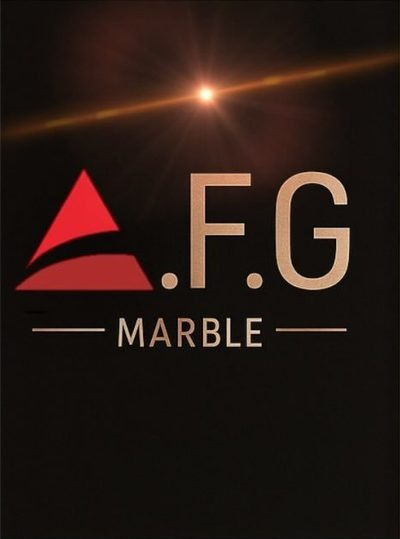

<div align="center">

  

  # A.F.G MARBLE
  ### Shilpā Marble Atelier — Handcrafted Marble Temples & Pooja Rooms

  <p align="center">
    <strong>An immersive, ultra-luxury interactive 3D WebGL experience bringing four generations of Rajasthani artisanal stonecraft into the modern digital age.</strong>
  </p>

  <p align="center">
    <a href="https://vitejs.dev/"></a>
    <a href="https://threejs.org/"></a>
    <a href="https://greensock.com/gsap/"></a>
    <a href="https://www.khronos.org/opengl/wiki/Core_Language_(GLSL)"></a>
    
  </p>

</div>

---

## 🏛️ Executive Summary

**A.F.G Marble (Shilpā Marble Atelier)** crafts bespoke marble temples, pooja rooms, and murtis sculpted from world-renowned Makrana marble by fourth-generation master artisans of Rajasthan. 

This repository houses the flagship interactive 3D web application — an architectural showcase engineered with **Three.js**, custom **GLSL triplanar shaders**, **GSAP animations**, and an editorial luxury design system. It allows clients worldwide to inspect temple craftsmanship, explore stone textures in real-time, and experience physical temple lighting in true 3D.

---

## ✨ Key Highlights & Features

### 🌟 1. Procedural 3D Temple Architecture
- **Heritage Mandap & Shikhar:** Procedurally sculpted temple geometry featuring multi-tiered plinths, stepped moldings, fluted columns, carved archways, and Sanctum Sanctorum (*Garbhagriha*) details.
- **24K Gold-Leaf Kalash:** Shimmering gilded finial crafted with physical gold micro-roughness and clearcoat sheen.
- **Interactive Hotspots:** Screen-projected 3D annotations anchored to temple architectural elements (Pillars, Kalash) displaying artisan chisel hours and guild details.

### 🪨 2. Real-Time Dynamic Marble Switching
Inspect the temple across 5 world-class luxury marble stones with seamless live transition:
| Marble Stone | Origin | Characteristic |
| :--- | :--- | :--- |
| **Makrana White** | Makrana, Rajasthan | Iconic stone of the Taj Mahal — crystalline purity |
| **Calacatta Oro** | Tuscany, Italy | White crystalline base with warm liquid-gold veining |
| **Botticino Classico**| Brescia, Italy | Warm ivory tones with subtle, timeless golden plumes |
| **Rosa Portogallo** | Alentejo, Portugal | Delicate blush rose with subtle crystalline striations |
| **Nero Marquina** | Basque Country, Spain | Deep midnight black with stark white calcitic veins |

### ⚡ 3. Custom GLSL Shader Pipeline
- **Object-Space Triplanar Mapping:** Eliminates UV seam distortions on complex architectural curvatures, flutings, and moldings by projecting textures along local XYZ normal weightings.
- **Height-Gradient Gold Wipe Shader:** Seamlessly transitions materials from bottom-to-top using an animated height threshold accompanied by an incandescent 24-karat gold molten boundary line.
- **Physical PBR Lighting:** Utilizes Three.js `MeshPhysicalMaterial` with clearcoat reflections, studio HDR environment maps (`RoomEnvironment`), directional sun key lights, and soft ground shadows.

### 🎨 4. Haute Couture Editorial UI / UX
- **Custom Magnetic Cursor:** Fluid physics cursor with magnetic attraction to interactive triggers and dynamic label states (`Drag`, `Inspect`).
- **Glassmorphism Stone Rail:** Floating stone selector rail displaying stone origins, historical notes, and active swatch indicators.
- **Kinetic Typography:** Typographic pairing featuring *Cormorant Garamond*, *Italiana*, and *Manrope*.
- **Smooth Inertia & Parallax:** Fluid rotation physics with inertia dampening and subtle mouse/gyro parallax responsiveness.

---

## 🛠️ Technology Stack

| Layer | Technologies |
| :--- | :--- |
| **Core & Bundler** | HTML5, JavaScript (ES Modules), [Vite 8](https://vitejs.dev/) |
| **3D Rendering** | [Three.js r186](https://threejs.org/) (WebGL, MeshPhysicalMaterial, RoomEnvironment) |
| **Shader Programming**| Custom GLSL (Triplanar mapping, Animated Wipe with Gold Trim) |
| **Animation Engine** | [GSAP 3.15](https://greensock.com/gsap/) (Timelines, Staggers, Easing) |
| **Styling & Design** | Vanilla CSS (CSS Custom Properties, Glassmorphism, Micro-interactions) |
| **Typography** | Cormorant Garamond, Italiana, Manrope (Google Fonts) |

---

## 📂 Project Architecture

```plaintext
afg_marbels/
├── public/
│   ├── afg-logo.jpeg            # A.F.G Marble official brand insignia
│   ├── favicon.svg              # SVG temple icon
│   └── textures/                # High-resolution PBR marble textures
│       ├── makrana.jpg          # Makrana White marble texture
│       ├── calacatta.jpg        # Calacatta Oro marble texture
│       ├── botticino.jpg        # Botticino Classico marble texture
│       ├── rosa.jpg             # Rosa Portogallo marble texture
│       └── nero.jpg             # Nero Marquina marble texture
├── src/
│   ├── main.js                  # Application controller, cursor, GSAP timelines, UI binding
│   ├── scene.js                 # Three.js scene graph, procedural geometry, custom shaders
│   └── style.css                # Luxury design system, glassmorphism, responsive styles
├── index.html                   # Semantic markup, meta tags, and WebGL canvas mount
├── package.json                 # Project dependencies and Vite build scripts
└── README.md                    # Project documentation
```

---

## 🚀 Getting Started

### Prerequisites
Make sure you have [Node.js](https://nodejs.org/) (version 18.x or later) installed on your system.

### Installation

1. **Clone the repository:**
   ```bash
   git clone https://github.com/PiyushASSUDANI123/afg_marbles.git
   cd afg_marbles
   ```

2. **Install project dependencies:**
   ```bash
   npm install
   ```

3. **Start the local development server:**
   ```bash
   npm run dev
   ```
   Open your browser and navigate to `http://localhost:5173`.

---

## 📦 Production Build

To compile and minify the project for production deployment:

```bash
npm run build
```

To preview the built production bundle locally:

```bash
npm run preview
```

The compiled assets will be output to the `dist/` folder, ready to be hosted on Vercel, Netlify, GitHub Pages, or AWS S3 / CloudFront.

---

## 🔬 Shader Implementation Details

### Seamless Triplanar Texture Projection
Standard 2D UV mapping often causes seam tearing or stretching on sculpted curved surfaces (pillars, domes, stepped cornices). This project injects custom GLSL code into `MeshPhysicalMaterial`:

```glsl
vec3 triplanar(sampler2D t, vec3 p, vec3 n) {
  vec3 b = pow(abs(n), vec3(6.0));
  b /= (b.x + b.y + b.z + 1e-5);
  vec3 cx = texture2D(t, p.zy * uScale + 0.5).rgb;
  vec3 cy = texture2D(t, p.xz * uScale + 0.5).rgb;
  vec3 cz = texture2D(t, p.xy * uScale + 0.5).rgb;
  return cx * b.x + cy * b.y + cz * b.z;
}
```

### Height-Based Gold Melt Transition
When a user switches stone swatches, an animated uniform `uMix` sweeps from 0.0 to 1.0. A height gradient calculates the frontier, blending Texture A into Texture B while igniting an emissive molten gold crest:

```glsl
float edge = smoothstep(0.0, 0.06, 0.06 - abs(heightNorm - uMix));
vec3 finalColor = mix(stoneA, stoneB, step(heightNorm, uMix));
finalColor += vec3(1.0, 0.84, 0.3) * edge * 2.2; // 24K gold luminescence
```

---

## 📱 Responsiveness & Browser Support

- **Desktop & Laptops:** Full high-fidelity WebGL rendering, custom cursor, 60 FPS inertia orbit.
- **Tablets & Mobile:** Touch-based drag rotation, responsive stone selector drawer, optimized pixel ratio capping for battery and thermal efficiency.
- **Tested Browsers:** Chrome, Safari (macOS & iOS), Firefox, Microsoft Edge.

---

## 📄 License & Credits

- **Brand & Atelier:** [A.F.G Marble](https://github.com/PiyushASSUDANI123/afg_marbles) / Shilpā Marble Atelier, Jaipur, Rajasthan.
- **Heritage Craft:** Dedicated to the master marble artisans preserving century-old Indian temple craftsmanship.
- **License:** Proprietary & Private — All rights reserved by A.F.G Marble.
